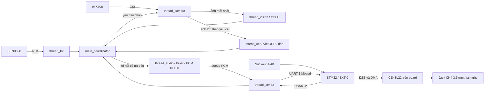

# Smart Glass v2 — Pi 5 + ToF + STM32

Bản này dùng **ToF SEN0628 nối trực tiếp Pi qua I2C; tai nghe cắm jack 3,5 mm CN4 trên STM32F411E-DISCO**.
Pi tạo âm thanh và gửi PCM qua UART; STM32 phát bằng I2S/DMA qua CS43L22, đồng thời đọc nút xanh. Tất cả lời thông báo
Piper và comment giải thích do dự án viết đều bằng tiếng Việt.

**Không chỉ nạp một file C là chạy toàn bộ:** cần nạp firmware âm thanh/nút vào STM32,
cài chương trình Python/model trên Pi và kiểm tra dây nối UART.
Code, firmware, model và đầu ra mới đều nằm trong `smart_glass_v2/`.

## 1. Trạng thái bàn giao

- Đã có sáu luồng: camera, ToF, YOLO, OCR/tiền, UART, âm thanh; queue có giới hạn.
- Có test mô phỏng trên máy tính, công cụ test từng thiết bị và firmware đã build ARM GCC.
- Chưa chạy trên Pi/STM32/cảm biến thật trong phiên làm việc này; chưa đo FPS, RAM hay độ trễ thực tế.
- Chưa kèm trọng số model. Có script cài model công khai ở mục 5; model mặt đường,
  vạch sang đường và tiền VND cần trọng số phù hợp của bạn.
- Mặc định `tof.calibrated=false`: vẫn đọc ToF và cảnh báo vật gần; chưa gán khoảng
  cách cho đối tượng hoặc nói hướng khoảng trống trước khi căn chỉnh.
- Chương trình chỉ báo chuyển động quan sát được, **không kết luận “an toàn sang đường”**
  từ bbox đứng yên. Camera không quan sát hết xe rẽ, xe khuất hoặc ngoài khung hình.

## 2. Sơ đồ và chức năng



| Người dùng thao tác | Kết quả |
| --- | --- |
| Nhấn ngắn rồi thả nút xanh | Chụp ảnh để đọc văn bản khi đang rảnh |
| Nhấn ngắn trong 5 giây sau khi **đọc xong** lời hỏi sang đường | Xác nhận quan sát xe qua 10 khung hình mới |
| Giữ ≥1,2 giây rồi thả | Chụp để nhận diện tiền; thông báo chưa cài nếu thiếu model |
| Nhấn khi đang đọc lời hỏi sang đường | Bỏ qua, chờ đọc xong để tránh xác nhận vô tình |
| Nhấn trong khi đang xử lý ảnh | Báo đang bận, không chụp chồng yêu cầu |

LED đỏ trên STM32 chốt sáng sau khi nhấn hợp lệ, reset board để tắt.
LED dành cho người lắp kiểm tra; người dùng khiếm thị thao tác bằng nút và nghe
lời nhắc trong tai nghe. Có lời báo khởi động, đang chụp, đang bận và kết quả.
Nếu chính đường âm thanh hỏng thì không thể báo lỗi qua tai nghe; bản này chưa có
bộ rung dự phòng để báo tình trạng đó.
Ảnh OCR lấy từ camera ở thời điểm xử lý yêu cầu, **không chụp màn hình desktop**.
Chạy headless qua SSH/systemd, không cần màn hình hay biến `DISPLAY`.

## 3. Nối dây

Tắt nguồn khi đổi dây. Bảng dùng **số chân vật lý 40-pin của Pi**, không phải số GPIO
BCM. STM32 lấy nguồn qua cổng ST-LINK; Pi lấy nguồn riêng phù hợp Pi 5; nối GND chung.

### Pi ↔ SEN0628

| Raspberry Pi 5 | SEN0628 |
| --- | --- |
| Pin 1 — 3V3 | VCC/+ |
| Pin 6 — GND | GND/− |
| Pin 3 — GPIO2/SDA1 | SDA/D |
| Pin 5 — GPIO3/SCL1 | SCL/C |

Đối chiếu chữ in trên module thay vì chỉ dựa vào màu dây. Chọn chế độ **I2C** trên
module; mặc định địa chỉ 7-bit `0x33` (JSON ghi `51`). Công tắc địa chỉ có thể chọn
`0x30..0x33`. Tháo dây I2C trước đây nối tới STM32. Không cắm đồng thời nguồn USB
vào cảm biến trong sơ đồ cấp 3V3 này. Dùng 3V3 để đường kéo lên I2C phù hợp GPIO Pi.

SEN0628 có RP2040 xử lý VL53L7CX: cần giao thức module DFRobot, không dùng driver
thanh ghi VL53L7CX trần. Góc nhìn hãng công bố **60° ngang × 60° dọc**, khác con số
45° trong đặc tả ban đầu. Nguồn: [DFRobot SEN0628](https://wiki.dfrobot.com/sen0628).

### Pi ↔ STM32 USART2

| Raspberry Pi 5 | STM32F411E-DISCO |
| --- | --- |
| Pin 8 — GPIO14/TXD0 | PA3 / USART2_RX |
| Pin 10 — GPIO15/RXD0 | PA2 / USART2_TX |
| Pin 9 — GND | GND |

Logic 3V3, **1.000.000 baud**, 8N1. Không nối đường 5V giữa hai board trong cách cấp nguồn riêng.
Âm thanh 16 kHz × 16 bit mono cần 32.000 byte/giây; 115200 baud không đủ.
UART dùng gói nhị phân CRC/ACK, không gửi nguyên chuỗi MP3 hoặc lệnh ASCII.
PA0 và LED PD14 đã có sẵn trên Discovery, không cần dây ngoài.

**Tùy chọn USB-UART:** bộ chuyển đổi TTL 3V3 hỗ trợ 1 Mbaud cắm USB Pi, TX→PA3, RX←PA2, GND chung;
để chân VCC của adapter không nối. Sửa `stm32.port` thành `/dev/ttyUSB0` hoặc đường
dẫn ổn định `/dev/serial/by-id/...`. Không mặc định cổng ST-LINK sẽ nối UART PA2/PA3.

### Camera và tai nghe

- IMX708/Camera Module 3 → cổng CAM/DISP Pi 5 bằng cáp đúng loại 22-pin phía Pi,
  15-pin phía module; gắn đúng mặt tiếp xúc khi đã tắt nguồn.
- Tai nghe → **jack CN4 3,5 mm trên STM32F411E-DISCO**. Đường DAC/khuếch đại tai nghe
  là chip CS43L22 có sẵn trên board; không cần USB sound card.
- Các dây codec đã nối trên PCB: PB6/PB9 = I2C1 SCL/SDA, PD4 = reset codec,
  PA4 = I2S WS, PC7 = MCLK, PC10 = CK, PC12 = SD. Không dùng các chân này cho thiết bị khác.
  [Sơ đồ và tài liệu Discovery của ST](https://www.st.com/resource/en/user_manual/um1842-discovery-kit-with-stm32f411ve-mcu-stmicroelectronics.pdf).

## 4. Chuẩn bị Pi OS và firmware

Mục tiêu Python **3.11.9**, Raspberry Pi OS 64-bit. Ví dụ dưới phù hợp bản Bookworm
có Python hệ thống 3.11; bản vá 3.11 khác vẫn dùng cùng cú pháp. Nếu OS dùng Python
3.13 thì không trộn `libcamera` của 3.13 vào venv 3.11; dùng bộ Python/Picamera2 cùng
phiên bản ABI. Đã kiểm tra cú pháp 3.11; máy phát triển chạy test bằng Python 3.12.

Nạp [firmware âm thanh/nút và hướng dẫn CubeIDE](firmware/README.md) trước khi test UART.
File nguồn cần dùng là `smart_glass_v2/firmware/main.c`, file nạp mới là
`smart_glass_v2/firmware/build/stm32_glass_audio.elf` hoặc `.hex`.

Các lệnh sau chạy **trên Pi**, giả sử tài khoản và nơi đặt dự án đúng như đặc tả:

```bash
sudo apt update
sudo apt install python3-venv python3-pip python3-picamera2 python3-opencv \
  python3-libcamera i2c-tools ffmpeg libgl1 libglib2.0-0
sudo usermod -aG video,render,dialout,i2c "$USER"
sudo raspi-config
```

Trong `raspi-config`: bật I2C; Serial Port → **login shell: No**, **serial hardware: Yes**.
Đăng xuất/đăng nhập sau khi đổi nhóm quyền. Trong `/boot/firmware/config.txt`, kiểm
tra/thêm dưới `[all]` (tránh lặp những dòng đã có):

```ini
dtparam=i2c_arm=on
dtparam=i2c_arm_baudrate=100000
enable_uart=1
dtoverlay=uart0-pi5
camera_auto_detect=1
```

Reboot rồi kiểm tra `/dev/i2c-1`, `/dev/ttyAMA0`. Pi 5 có UART debug riêng;
`/dev/serial0` không mặc nhiên là chân 8/10. Overlay `uart0-pi5` bật GPIO14/15 theo
[tài liệu overlay chính thức](https://github.com/raspberrypi/linux/blob/rpi-6.12.y/arch/arm/boot/dts/overlays/README).
Không để console/getty chiếm UART đang dùng. Nếu dùng USB-UART thì không cần overlay này.

```bash
cd /home/nguyenhoanghaidang/smart_glass
python3.11 -m venv --system-site-packages myenv
source myenv/bin/activate
python --version
python -m pip install --upgrade pip
python -m pip install -r smart_glass_v2/requirements.txt
python -m pip check
python -c "import numpy, cv2, torch, picamera2, libcamera; print(numpy.__version__, cv2.__version__, torch.__version__)"
```

`--system-site-packages` để thấy Picamera2/libcamera từ apt. requirements giữ NumPy
1.x và OpenCV 4.11 vì RapidOCR 1.3.24 không hỗ trợ NumPy 2. Hai gói OpenCV cùng phiên
bản được kéo bởi các dependency khác nhau; chương trình không gọi cửa sổ GUI.
Không cài bằng `sudo pip` và không ghi đè Python hệ thống. Chưa xác nhận resolver
và tất cả wheel trên chính Pi của bạn; `pip check` và lệnh import phải qua trước.

## 5. Chuẩn bị model

Chỉ bước cài đặt này cần mạng; chương trình chính yêu cầu file cục bộ có sẵn:

```bash
cd /home/nguyenhoanghaidang/smart_glass/smart_glass_v2
python prepare_models.py --yolo --ocr --piper
```

Lệnh tải YOLO11n COCO và giọng Việt Piper, sao chép DBNet trong wheel RapidOCR,
tải cấu hình/trọng số VietOCR `vgg_seq2seq`. Lưu dấu vân tay vào `models/sha256.json`;
không ghi đè YOLO/OCR đã có. Nếu máy offline, chép đủ các file theo
[models/README.md](models/README.md) từ máy đã chuẩn bị.

**YOLO11n COCO không có `road`, `sidewalk`, `zebra_crossing`.** Nó chạy được phát
hiện người/xe; hai chức năng mặt đường và vạch sang đường tự tắt nếu thiếu nhãn.
Muốn dùng đầy đủ phải cung cấp model đã huấn luyện những lớp đó, ưu tiên segmentation
cho vùng mặt đường. Tên lớp thực tế hiện trong log khi chạy.

`../best.pt` hiện được tài liệu cũ xác định là YOLO26n-seg, train bằng Ultralytics
8.4.138, **cũng thiếu các lớp mặt đường/vạch sang đường**. Code mới không đổi/ghi đè
file này. Nếu chọn nó, kiểm tra phiên bản Ultralytics tương thích và cấu hình đường dẫn
`vision.model`; không đổi nhãn `street_obstacle` thành `road` để giả làm mặt đường.

Model tiền tùy chọn `models/currency.pt`, class `vnd_1000`…`vnd_500000`; có thể đổi
bảng ánh xạ `currency.labels`. Chưa có model thì nhấn giữ sẽ nghe “Chức năng nhận
diện tiền chưa sẵn sàng.” Không có phần huấn luyện tiền tự động trong bản này.

## 6. Test từng thiết bị

Chạy trong `smart_glass_v2/`, đã kích hoạt venv. Dừng service/chương trình đang giữ
cùng camera/UART/audio trước khi test riêng.

### 6.1 ToF

```bash
i2cdetect -y 1
python diagnose.py tof --config config.local.json --duration 20
```

Phải thấy địa chỉ module và ma trận 8×8, đơn vị mét. Đưa một bìa phẳng trắng trước
cảm biến, thay đổi 0,5 → 1 → 2 mét; ô tương ứng phải thay đổi. `--` là không đo được,
không được coi là khoảng trống. Bỏ màng bảo vệ đầu dò. Cho module vài giây khởi động;
driver chờ khởi động 3 giây và sau đổi chế độ 8×8 thêm 5 giây.

Nếu timeout: kiểm tra công tắc I2C, địa chỉ, GND, SDA/SCL; chạy test khi chỉ một
chương trình dùng bus. Firmware SEN0628 v1.3 sửa lỗi giá trị ngoài tầm; giá trị
4000 trở lên được loại bỏ. [Hướng dẫn cập nhật của DFRobot](https://wiki.dfrobot.com/sen0628/docs/21564).

### 6.2 Nút STM32

```bash
python diagnose.py button --config config.local.json --duration 30
```

Nhấn ngắn → hiện **một** `BTN_SHORT`; giữ 1,2 giây rồi thả → **một** `BTN_CURRENCY`.
Đỏ sáng nhưng không hiện lệnh: kiểm tra PA2→RX, PA3←TX, GND, baud, thiết bị UART.
Đèn cam sáng: codec chưa khởi tạo được hoặc DMA lỗi; đèn cam chớp nhanh: lỗi clock HSE.
Không thấy LED đỏ: kiểm tra đã nạp đúng ELF, bấm Resume nếu debugger đang giữ CPU,
đúng board/nút PA0. Giao thức mới là **binary phiên bản 2**, không tương thích bản
nút ASCII 115200 trước đó hoặc firmware audio phiên bản 1 ở thư mục cha.

### 6.3 Camera

```bash
rpicam-hello --list-cameras
python diagnose.py camera --duration 10
```

Lệnh thứ hai lưu `test_camera.jpg`; mở ảnh để kiểm tra chiều, nét và chữ rõ.
Không chạy `rpicam-hello` đồng thời với chương trình Python.
Camera owner duy nhất chia ảnh YOLO 640×360 và ảnh OCR 2304×1296.

### 6.4 Tai nghe trên STM32: test từ tiếng bíp đến Piper

```bash
python diagnose.py audio --tone --config config.local.json --duration 10
```

Nạp firmware mới, cắm tai nghe vào CN4 và nối UART trước khi chạy. Lệnh này tạo
tiếng 440 Hz dài một giây, biên độ thấp; **không cần model Piper/YOLO/OCR**.
Terminal hiện `Codec: 1`; nghe được tiếng bíp xác nhận đường Pi→UART→STM32→jack.
Codec: 1 chỉ là kết quả khởi tạo, không tự chứng minh tai nghe thực sự phát tiếng.

Sau khi cài giọng Piper, thử lời nói tiếng Việt:

```bash
python diagnose.py audio --config config.local.json --duration 60
```

Phải nghe “Xin chào. Đây là kiểm tra âm thanh qua tai nghe cắm vào bo STM32.”
Firmware khởi tạo master volume codec ở -20 dB. Volume thuộc CS43L22, không phải
volume loa desktop Pi. Cần đo/nghe kiểm tra trước khi chọn mức âm lượng dùng hằng ngày.

Muốn thử MP3 riêng:

```bash
python diagnose.py audio --wav /duong/dan/baihat.mp3 --duration 240
```

Đặt `--duration` dài hơn thời lượng file và thời gian chuyển đổi. FFmpeg đổi
MP3/WAV sang PCM mono 16-bit 16000 Hz rồi truyền UART. **Bật nhạc bằng ứng dụng
bất kỳ trên Pi chưa tự chuyển sang STM32**; phải dùng đường truyền này. Trợ lý
tự dùng nó cho Piper. Dừng service trước khi test riêng để không tranh cổng UART.

Nếu không nghe: kiểm tra ELF đã nạp, baud 1 Mbaud, dây TX/RX và GND, Codec phải là 1.
Nếu tiếng giật: xem `thiếu mẫu`, `lỗi UART`, `tràn RX`, rút ngắn dây, kiểm tra nguồn.
Nếu codec không khởi tạo: kiểm tra reset PD4, I2C1 địa chỉ 0x4A, clock I2S3 và đúng
board Discovery. Các bước kiểm tra này dành cho người lắp thiết bị.

## 7. Căn chỉnh camera–ToF

`config.local.json` ghi đè từng khóa của `config.py`, không cần chép toàn bộ cấu hình.
Mọi đường dẫn model tương đối tính từ thư mục `smart_glass_v2`.

1. Gắn camera và ToF gần nhau, cố định hướng. Góc nhìn camera phụ thuộc bản Standard/Wide
   và crop cảm biến; `camera.hfov_deg=75` chỉ là giá trị khởi đầu theo đặc tả.
2. Dùng test camera và ToF riêng: đưa mục tiêu trái/phải/trên/dưới để xác định chiều ma trận.
3. Điều chỉnh `tof.rotate_quarters` (0..3), `flip_x`, `flip_y`; sau biến đổi, cột 0
   phải là phía trái của ảnh camera, hàng 0 là phía trên.
4. Đối chiếu vật tại nhiều vị trí/khoảng cách; sửa FOV, `yaw_deg`, `pitch_deg` cho
   phù hợp. Góc dương yaw nghĩa là trục ToF lệch phải so với camera; pitch dương lệch xuống.
5. Chỉ sau đối chiếu thành công mới đặt `calibrated=true`. Ví dụ cấu hình ban đầu:

```json
{
  "tof": {"address": 51, "calibrated": false, "rotate_quarters": 0,
          "flip_x": false, "flip_y": false, "yaw_deg": 0, "pitch_deg": 0},
  "camera": {"hfov_deg": 75},
  "stm32": {"port": "/dev/ttyAMA0", "baud": 1000000}
}
```

Phép chiếu dùng vùng giữa 35% bbox, trung bình các ô giao nhau còn hợp lệ; chia vị
trí thành 9 vùng. Không kéo vật ngoài FOV vào ô biên. Dữ liệu quá 0,5 giây hoặc lệch
ảnh quá 0,2 giây không được ghép. Timestamp hiện là lúc lấy ảnh/đọc phản hồi ở host,
chưa đồng bộ thời điểm phơi sáng và phép đo cảm biến. Mô hình chỉ hiệu chỉnh góc,
chưa bù đầy đủ méo ống kính và thị sai do hai cảm biến cách nhau; sai số tăng ở gần.

## 8. Chạy toàn bộ và tự khởi động

```bash
python main_coordinator.py --config config.local.json --check
python main_coordinator.py --config config.local.json
```

`--check` chỉ kiểm tra file, thư viện và quyền thiết bị; không khẳng định model load
được hoặc phần cứng hoạt động. Hãy thực hiện mục 6. Ctrl+C dừng chương trình.

Khi đã chạy thủ công được, sửa **User**, **WorkingDirectory**, **ExecStart** trong
`smart_glass.service` nếu tên tài khoản/thư mục khác ví dụ rồi cài:

```bash
sudo cp smart_glass.service /etc/systemd/system/smart_glass.service
sudo systemctl daemon-reload
sudo systemctl enable smart_glass.service
sudo systemctl start smart_glass.service
systemctl status smart_glass.service
journalctl -u smart_glass.service -f
```

Sau khi sửa JSON/model: `sudo systemctl restart smart_glass.service`.
Dừng để test riêng: `sudo systemctl stop smart_glass.service`.
Nếu lỗi liên tiếp bị giới hạn restart: sửa nguyên nhân rồi
`sudo systemctl reset-failed smart_glass.service` và `sudo systemctl start smart_glass.service`.

Dịch vụ không cần desktop hoặc ALSA/PipeWire; âm thanh được gửi qua UART STM32.
systemd chờ 12 giây khi dừng rồi thu
hồi cả tiến trình con nếu driver/native inference không trả về.

## 9. Thuật toán và giới hạn hiện tại

- **Vật thể:** 1–3 vật → tên Việt, vùng ảnh, khoảng cách nếu có phép ghép hợp lệ.
  Tên model chưa dịch trong `labels.vi` được đọc là “vật thể”.
- **Vật cản:** hơn 4 ô dưới 0,7 m hoặc ≥5 vật → quét cột, chọn cụm liền nhau
  có trung bình lớn nhất. Cột chứa điểm gần hoặc thiếu quá nhiều ô không được
  coi là thoáng. Ô gần vùng giữa ưu tiên lời “Hãy dừng lại”.
- **Hướng khoảng trống:** chỉ nói hướng quan sát được sau hiệu chuẩn; không coi
  ma trận 8×8 là bằng chứng lối đi chắc chắn không có ổ gà/vật cản ngoài vùng đo.
- **Mặt đường:** vùng `road/street` chiếm ≥50% dải dưới 30%, vỉa hè <15% → cảnh báo
  dừng/xác định vị trí. Dùng polygon nếu model có mask, bbox nếu không có; bbox
  là xấp xỉ thô. Không đoán trái/phải lên vỉa hè khi không có đủ bằng chứng.
- **Sang đường:** 5 giây tính sau `audio_done`. Đếm 10 frame khác nhau, ghép xe
  theo class/IoU, xét vận tốc tâm, độ dịch tổng và biến đổi diện tích. Camera rung,
  mất track, thiếu xe hoặc gap lớn → không đủ dữ liệu. Xe nhìn như đứng yên chỉ
  dẫn tới lời “chưa thấy xe chuyển động rõ; chưa thể xác nhận an toàn sang đường”.
- **OCR:** DBNet → cắt từng dòng phối cảnh → VietOCR → chuẩn Unicode NFC,
  dấu câu/khoảng trắng, bỏ dòng liền nhau trùng. `ocr.replacements` cho phép từ điển
  sửa lỗi đã biết; không tự đoán dấu/câu làm sai tên, số tiền hoặc nội dung gốc.
  Thứ tự dòng hiện sắp từ trên xuống rồi trái sang phải, chưa xử lý bố cục nhiều cột.
- **Âm thanh:** Piper → FFmpeg/PCM 16 kHz → queue UART → ring PCM STM32 → I2S3/DMA
  → CS43L22 → CN4. Một luồng duy nhất sở hữu UART, nhận nút trong suốt lúc phát.
  CRC/ACK chống lỗi và tràn ring; gửi lại cùng sequence không nhân đôi mẫu.
  Cảnh báo khẩn hủy lời thường, gửi STOP, bỏ PCM chưa phát; DMA có thể còn tối đa
  khoảng 32 ms dữ liệu cũ. `audio_done` chỉ phát sau DONE đúng mã lần phát/số mẫu
  hoặc heartbeat xác nhận tương ứng; cửa sổ xác nhận 5 giây bắt đầu từ đây.
  Lời chưa cache phải load Piper trong tiến trình con nên có độ trễ lần đầu;
  cache WAV giới hạn 16 đoạn. STM32 tự bỏ đoạn dở nếu thiếu gói audio quá 1,5 giây.
- **Luồng/RAM:** ảnh mới thay ảnh cũ, không tích lũy hàng trăm frame. PyTorch dùng
  pool CPU chung 2 thread, detector OCR/Piper ONNX 1 thread. Đây không phải bảo đảm
  realtime; cần đo trên Pi 4GB khi cả YOLO, VietOCR và Piper cùng hoạt động.
- **Lỗi:** thiếu model bắt buộc → không chạy; ToF/UART mất kết nối → thử lại có chờ;
  camera/vision/audio lỗi → thoát để systemd khởi động lại. Watchdog tiến trình phát
  hiện worker không phản hồi; Python không thể cưỡng bức thoát một native call bị kẹt.

## 10. Test mô phỏng và cấu trúc mã

Từ thư mục gốc dự án, không cần Pi hoặc model:

```bash
python -X utf8 smart_glass_v2/main_coordinator.py --mock --duration 10 --mock-button-after 2
python -X utf8 -m unittest discover -s smart_glass_v2/tests -v
```

Mock dùng NumPy; bộ test có OCR crop cần OpenCV/Pillow. Mock chỉ in lời nói ra log,
không phát loa và không đo phần cứng. Tham số `--mock` phải bỏ khi chạy thật.

| File/thư mục | Vai trò |
| --- | --- |
| `main_coordinator.py` | Trạng thái, nút theo ngữ cảnh, ưu tiên cảnh báo, quản lý luồng |
| `config.py`, `config.local.json` | Mặc định và cấu hình riêng của bộ kính |
| `modules/thread_camera.py` | Chủ sở hữu Picamera2 duy nhất |
| `modules/thread_tof.py` | Giao thức SEN0628, timeout, ma trận 8×8 |
| `modules/thread_vision.py` | YOLO, vùng mặt đường, đối tượng xe, độ rung ảnh |
| `modules/thread_ocr.py` | DBNet/VietOCR và model tiền tùy chọn |
| `modules/thread_stm32.py` | UART PCM/nút, CRC, ACK/DONE, bỏ sự kiện trùng |
| `modules/thread_audio.py`, `modules/piper_synth.py` | Hàng đợi lời nói, tổng hợp và chuyển WAV |
| `utils/uart_audio.py`, `utils/uart_protocol.py` | Truyền PCM qua queue, chờ phát xong, hủy phát |
| `utils/` | Ghép hình học, quét hành lang, theo dõi xe, làm sạch văn bản, queue |
| `diagnose.py`, `prepare_models.py` | Test từng thiết bị và chuẩn bị model |
| `firmware/` | C, CMSIS/HAL, linker/build và ELF/HEX cho nút + CS43L22 |
| `tests/` | Kiểm thử có dữ liệu cố định và worker giả |

Mỗi module luồng có `run_thread(queues, stop_event)`. Thêm subsystem bằng một
`thread_*.py`, queue có giới hạn trong `utils/channels.py`, cấu hình trong `config.py`
và tên worker trong `WORKERS`. Chỉ một thread sở hữu mỗi thiết bị; gửi yêu cầu qua queue.

Nguồn API đã đối chiếu: [DFRobot driver](https://github.com/DFRobot/DFRobot_MatrixLidar),
[Picamera2 manual](https://datasheets.raspberrypi.com/camera/picamera2-manual.pdf),
[Ultralytics Predict](https://docs.ultralytics.com/modes/predict/),
[VietOCR](https://github.com/pbcquoc/vietocr),
[RapidOCR 1.3.24](https://github.com/RapidAI/RapidOCR/tree/v1.3.24/python/rapidocr_onnxruntime),
[Piper Python API](https://github.com/OHF-Voice/piper1-gpl/blob/main/docs/API_PYTHON.md).
